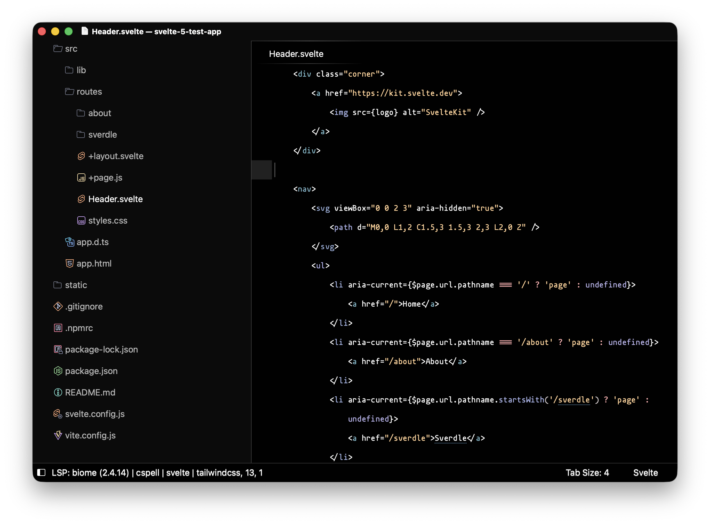

# Icons - Catppuccin



## Getting started

Install `Icons - Catppuccin` from https://packages.sublimetext.io/

Or clone the repo in Sublime Text "Packages" folders:
```bash
git clone https://github.com/predragnikolic/catppuccin-sublime-icons.git "Icons - Catppuccin"
```
Select `Preferences: Settings` in the command palette and set:
```jsonc
// Preferences.sublime-settings
{
    "file_icon_theme": "Catppuccin Mocha.sublime-file-icons"
}
```

Tweak your current theme, so the icons look nice.
Open the command palette and select `UI: Customize Theme`:
```jsonc
{
    "rules": [
        // Fix stretched file icons
        {
            "class": "icon_file_type",
            "content_margin": 8,
            "layer0.opacity": 1.0, // tweak opacity to your liking
            "layer0.texture": "Icons - Catppuccin/icons/file_type_text.png",
            // "layer0.tint": [0, 0, 0, 150], // enable monochrome icons (good for light themes)
        },

        // Change open/close folder icons
        {
            "class": "icon_folder",
            "layer0.texture": "Icons - Catppuccin/icons/file_type_folder.png",
            "content_margin": 8,
            "layer0.opacity": 1.0, // tweak opacity to your liking
            // "layer0.tint": [0, 0, 0, 150], // enable monochrome icons (good for light themes)
        },
        {
            "class": "icon_folder",
            "parents": [{"class": "tree_row", "attributes": ["expanded"]}],
            "layer0.texture": "Icons - Catppuccin/icons/file_type_folder_open.png",
        },

        // Hides Folder Arrows
        {
            "class": "disclosure_button_control",
            "content_margin": 0,
        },
    ]
}

```

## 💝 Thanks to

- [catppuccin/zed-icons](https://github.com/catppuccin/zed-icons)
- [tecandrew](https://github.com/tecandrew)

